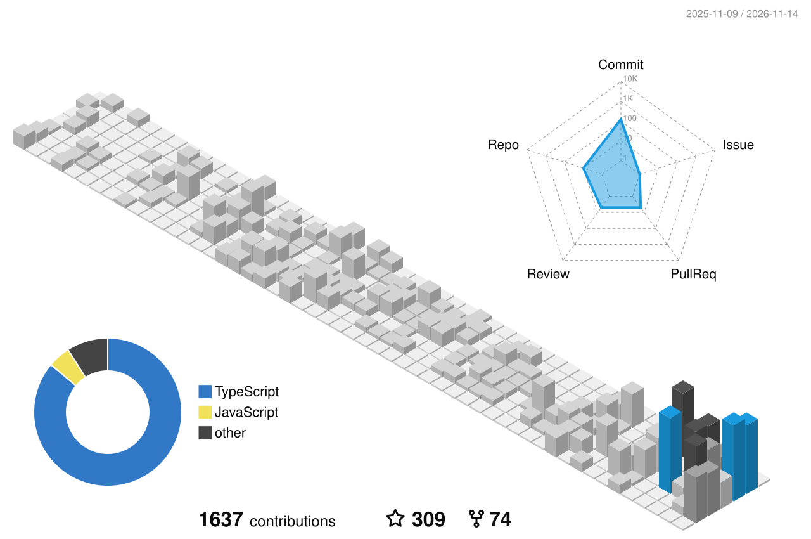

<picture>
  <source media="(prefers-color-scheme: dark)" srcset="https://raw.githubusercontent.com/goncy/goncy/main/assets/hero-dark.svg">
  
</picture>

  <a href="https://x.gonzalopozzo.com"><picture><source media="(prefers-color-scheme: dark)" srcset="https://raw.githubusercontent.com/goncy/goncy/main/assets/social/x-dark.svg"></picture></a>
  <a href="https://linkedin.gonzalopozzo.com"><picture><source media="(prefers-color-scheme: dark)" srcset="https://raw.githubusercontent.com/goncy/goncy/main/assets/social/linkedin-dark.svg"></picture></a>
  <a href="https://youtube.gonzalopozzo.com"><picture><source media="(prefers-color-scheme: dark)" srcset="https://raw.githubusercontent.com/goncy/goncy/main/assets/social/youtube-dark.svg"></picture></a>
  <a href="https://twitch.gonzalopozzo.com"><picture><source media="(prefers-color-scheme: dark)" srcset="https://raw.githubusercontent.com/goncy/goncy/main/assets/social/twitch-dark.svg"></picture></a>
  <a href="https://instagram.gonzalopozzo.com"><picture><source media="(prefers-color-scheme: dark)" srcset="https://raw.githubusercontent.com/goncy/goncy/main/assets/social/instagram-dark.svg"></picture></a>

I'm a frontend developer from Argentina, in love with React and Next.js, building for the web since 2012. Today I'm a **Forward Deployed Engineer at [▲ Vercel](https://vercel.com)**, working hands-on with customers building on Next.js and Vercel.

I'm also a [GitHub Star](https://stars.github.com/profiles/goncy), [v0](https://v0.app) and [Cypress](https://www.cypress.io/ambassadors) ambassador, [Twitch](https://twitch.gonzalopozzo.com) partner and the founder of [Pency](https://pency.app). Most of what I create is in Spanish and has one goal: helping people land their first (or a better) job in IT.

### Landing your first dev job?

Start here. Everything is free.

  <a href="https://twitch.gonzalopozzo.com"><picture><source media="(prefers-color-scheme: dark)" srcset="https://raw.githubusercontent.com/goncy/goncy/main/assets/card-twitch-dark.svg"></picture></a>
  <a href="https://github.com/goncy/interview-challenges"><picture><source media="(prefers-color-scheme: dark)" srcset="https://raw.githubusercontent.com/goncy/goncy/output/repo-interview-challenges-dark.svg"></picture></a>
   
  <a href="https://github.com/goncy/nextjs-course"><picture><source media="(prefers-color-scheme: dark)" srcset="https://raw.githubusercontent.com/goncy/goncy/output/repo-nextjs-course-dark.svg"></picture></a>
  <a href="https://github.com/goncy/aprender-en-tiempos-de-ia"><picture><source media="(prefers-color-scheme: dark)" srcset="https://raw.githubusercontent.com/goncy/goncy/output/repo-aprender-en-tiempos-de-ia-dark.svg"></picture></a>

### What I build with

<picture>
  <source media="(prefers-color-scheme: dark)" srcset="https://raw.githubusercontent.com/goncy/goncy/main/assets/stack-dark.svg">
  
</picture>

<b>My path so far</b>

 

| Year | Milestone |
| --- | --- |
| 2012 | First dev job, as an AS3 developer at Acceso Total |
| 2014 | Graduated in Multimedia Design at Da Vinci |
| 2015 | JavaScript developer at etermax |
| 2020 | Founded Pency, a free ecommerce platform that helped 30k+ stores get through COVID. Started streaming on Twitch |
| 2021 | Became a Twitch Partner and joined Vercel as a Solutions Architect |
| 2023 | Senior Solutions Engineer at Vercel |
| 2026 | Forward Deployed Engineer at Vercel |
| Along the way | GitHub Star, v0 Ambassador, Cypress Ambassador and freeCodeCamp Buenos Aires co-organizer |

### Activity

<picture>
  <source media="(prefers-color-scheme: dark)" srcset="https://raw.githubusercontent.com/goncy/goncy/output/stats-dark.svg">
  
</picture>

<picture>
  <source media="(prefers-color-scheme: dark)" srcset="https://raw.githubusercontent.com/goncy/goncy/output/contrib-3d-dark.svg">
  
</picture>

Stats refresh daily with GitHub Actions. Assets are generated by the scripts in this repo.

